# ExpenseTracker 💸

Aplicación móvil para **registrar y consultar gastos personales**, desarrollada con
**React Native** y **Expo** para el Proyecto Integrador de Programación III.

Este repositorio corresponde al **Sprint 1**: un prototipo navegable de la interfaz inicial.
Todavía no se guardan datos (no hay SQLite, Context ni APIs remotas). Los gastos que se ven son
datos de ejemplo definidos en el código.

**Autor:** roy luis garro ([@royluis1](https://github.com/royluis1))

---

## Tecnologías

| Herramienta | Uso |
| --- | --- |
| [Expo](https://expo.dev) (SDK 58, plantilla `blank`) | Framework para crear y ejecutar la app |
| React Native | Componentes nativos (`View`, `Text`, `TextInput`, `FlatList`, `Pressable`, `Image`, `Switch`…) |
| React Navigation 7 | Navegación con **Stack** (`native-stack`) y **Tabs** (`bottom-tabs`) |
| Expo Vector Icons (Ionicons) | Íconos de pestañas y categorías |

## Cómo ejecutar el proyecto

Requisitos: Node.js 22 o superior y la app **Expo Go** instalada en el celular (en la misma red Wi-Fi que la computadora).

```bash
git clone https://github.com/royluis1/ExpenseTracker.git
cd ExpenseTracker
npm install
npx expo start
```

Después se escanea el código QR con Expo Go (Android) o con la cámara (iPhone).
Si la red no permite la conexión, se puede usar `npx expo start --tunnel`.

También se puede abrir en el navegador con `npm run web`.

## Estructura del proyecto

```
ExpenseTracker/
├── App.js                     # Punto de entrada: NavigationContainer + StackNavigator
├── app.json                   # Configuración de Expo
├── assets/                    # Íconos y splash de la app (generados por Expo)
├── docs/screenshots/          # Capturas para este README
└── src/
    ├── components/            # Componentes reutilizables
    │   ├── CategoryIcon.js        círculo con el ícono y color de la categoría
    │   ├── CategoryPicker.js      selector de categoría (chips)
    │   ├── ExpenseItem.js         fila de un gasto en el listado
    │   ├── ExpensesTotal.js       tarjeta con el total de gastos
    │   ├── FormField.js           etiqueta + TextInput
    │   └── PrimaryButton.js       botón principal / con borde
    ├── screens/
    │   ├── HomeScreen.js          bienvenida (US3)
    │   ├── ExpensesScreen.js      listado de gastos (US5)
    │   ├── ExpenseDetailScreen.js detalle de un gasto
    │   ├── SettingsScreen.js      ajustes
    │   └── NewExpenseModal.js     formulario de carga (US4)
    ├── navigation/
    │   ├── TabNavigator.js        pestañas Inicio / Mis gastos / Ajustes
    │   └── StackNavigator.js      pila: pestañas + detalle + modal
    ├── assets/                # Imágenes propias de la app (ilustración de bienvenida)
    ├── data/                  # Datos de ejemplo (gastos y categorías)
    ├── theme/                 # Paleta de colores compartida
    └── utils/                 # Funciones auxiliares (formato de montos)
```

Además de las carpetas propuestas en la US2 se agregaron:

- **`data/`**: separa los datos de ejemplo de las pantallas. En el próximo Sprint, cuando se incorpore
  persistencia (SQLite), solo habrá que reemplazar esta capa sin tocar la interfaz.
- **`theme/`**: concentra los colores en un único archivo para mantener un estilo coherente y poder
  cambiarlo desde un solo lugar.
- **`utils/`**: funciones que no son componentes ni pantallas y se reutilizan en varios lugares
  (por ejemplo `formatCurrency`, que muestra `25000` como `$25.000`).

## Navegación

```
NavigationContainer
└── StackNavigator (native-stack)
    ├── Main ─────────── TabNavigator (bottom-tabs)
    │                    ├── Inicio      → HomeScreen
    │                    ├── Mis gastos  → ExpensesScreen
    │                    └── Ajustes     → SettingsScreen
    ├── ExpenseDetail ── ExpenseDetailScreen   (al tocar un gasto del listado)
    └── NewExpense ───── NewExpenseModal       (presentación modal)
```

- Desde **Inicio** se accede al listado ("Ver mis gastos") y al formulario ("Cargar un gasto").
- Desde **Mis gastos** se abre el detalle de cada gasto y, con el botón **+**, el formulario.
- En el formulario, **Guardar** valida los campos, muestra un `Alert` y cierra el modal;
  **Cancelar** vuelve atrás.

## User Stories del Sprint 1

| Código | User Story | Estado | Dónde |
| --- | --- | --- | --- |
| #rn-s1-us1 | Crear proyecto React Native con Expo | ✅ | Proyecto creado con `create-expo-app --template blank` |
| #rn-s1-us2 | Definir estructura del proyecto | ✅ | Carpeta `src/` (ver estructura) |
| #main-s1-us3 | Construir pantalla de bienvenida | ✅ | `src/screens/HomeScreen.js` |
| #main-s1-us4 | Construir formulario de carga de gastos | ✅ | `src/screens/NewExpenseModal.js` |
| #main-s1-us5 | Construir listado de gastos | ✅ | `src/screens/ExpensesScreen.js` |
| #rn-s1-us6 | Integrar todas las vistas del Sprint | ✅ | `src/navigation/` + `App.js` |
| #rn-s1-us7 | Bonus | ✅ | Íconos, colores por categoría, total y ilustración |

Detalle de lo pedido en cada una:

- **US3**: nombre ExpenseTracker, mensaje de bienvenida y descripción, con `View`, `Text` y `StyleSheet`.
- **US4**: `TextInput` para nombre y monto, selector de categoría y botón **Guardar** que responde a `onPress`
  (valida, hace `console.log` y muestra un `Alert`). Todavía no guarda información.
- **US5**: `FlatList` con Supermercado ($25.000), Combustible ($18.000) e Internet ($32.000), además de
  otros gastos de ejemplo. Cada fila muestra descripción, categoría y monto.
- **US6**: un Tab Navigator y un Stack Navigator funcionando; el listado y el formulario se acceden mediante navegación.
- **US7 (bonus)**:
  - Íconos con Expo Vector Icons (pestañas y categorías).
  - Un color distinto para cada categoría.
  - Total de gastos al final del listado.
  - Ilustración propia en `src/assets/welcome-illustration.png`, que se muestra en la pantalla de inicio.

## Capturas de pantalla

### Expo Go

| Bienvenida | Listado | Detalle |
| --- | --- | --- |
| 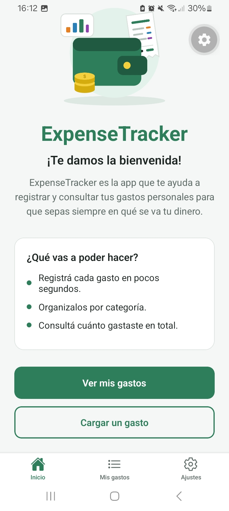 | 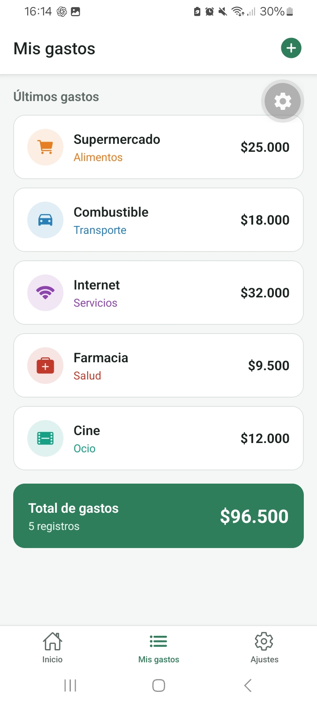 | 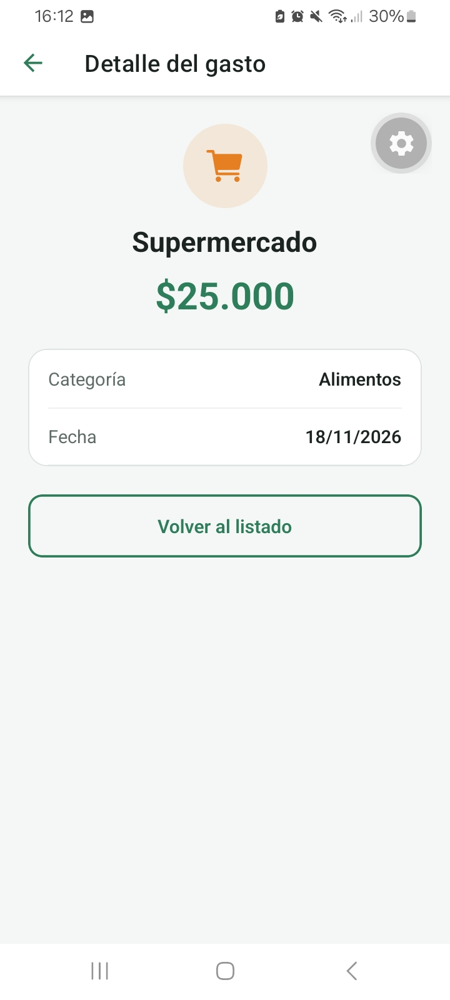 |

| Nuevo gasto | Gasto registrado (Alert) | Ajustes |
| --- | --- | --- |
| 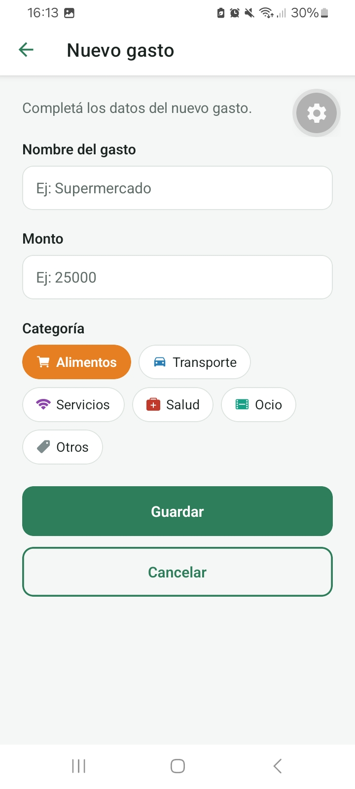 | 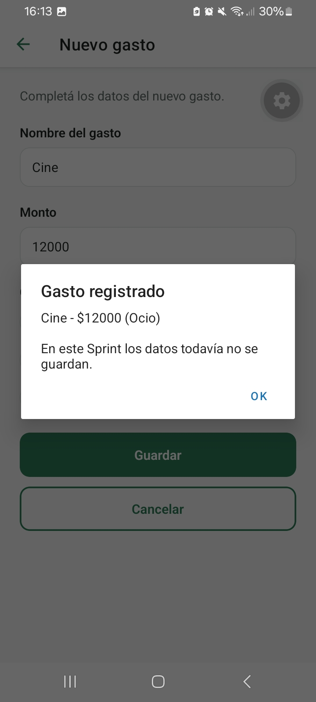 | 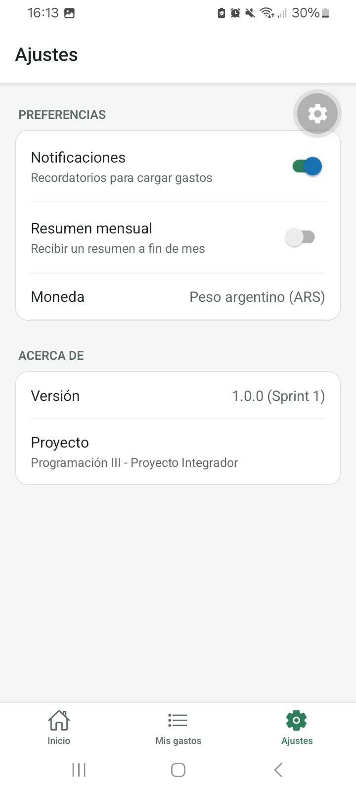 |

### Vista previa (versión web, `npm run web`)

| Bienvenida | Listado | Detalle |
| --- | --- | --- |
| 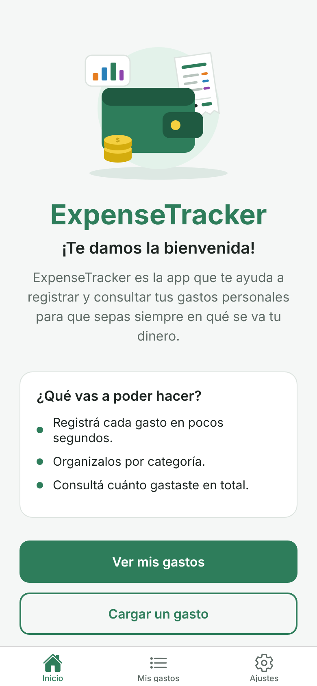 | 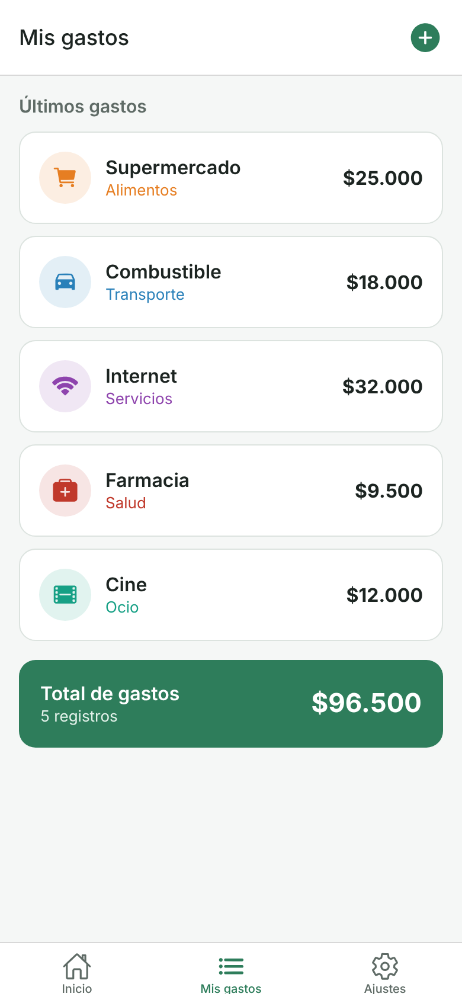 | 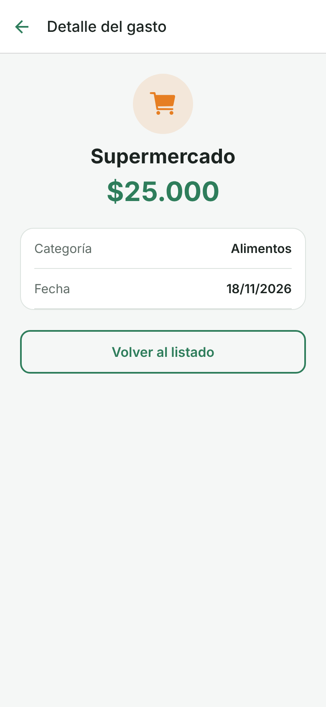 |

| Nuevo gasto | Ajustes |
| --- | --- |
| 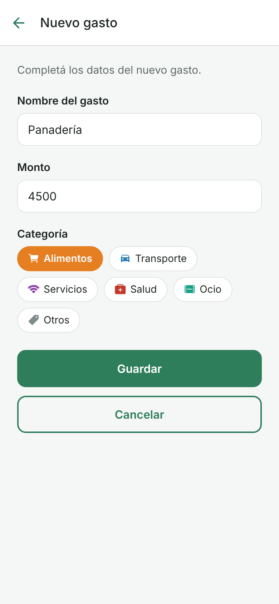 | 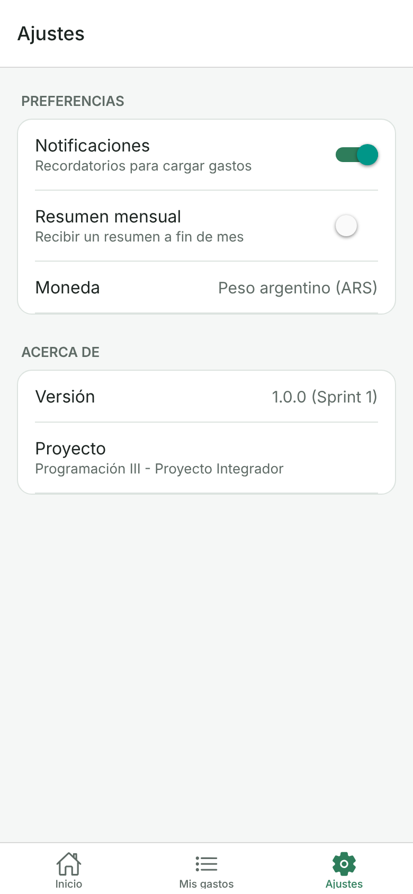 |

## Trabajo en ramas

Cada User Story se desarrolló en su propia rama y se integró con un merge (`--no-ff`), así
el historial muestra qué se hizo en cada una:

| Rama | Contenido |
| --- | --- |
| `feature/us2-estructura-proyecto` | Estructura de carpetas y pantallas base |
| `feature/us3-pantalla-bienvenida` | Pantalla de bienvenida |
| `feature/us4-formulario-gastos` | Formulario de carga y componentes de formulario |
| `feature/us5-listado-gastos` | Listado de gastos con datos de ejemplo |
| `feature/us6-navegacion` | Integración con React Navigation (Tabs + Stack) |
| `feature/us7-bonus` | Íconos, colores, total e ilustración |
| `docs/readme` | Este README y las capturas |

Se puede ver con:

```bash
git log --oneline --graph
```

## Próximos pasos

En el próximo Sprint se incorporará gestión de estado y persistencia de datos con SQLite.
